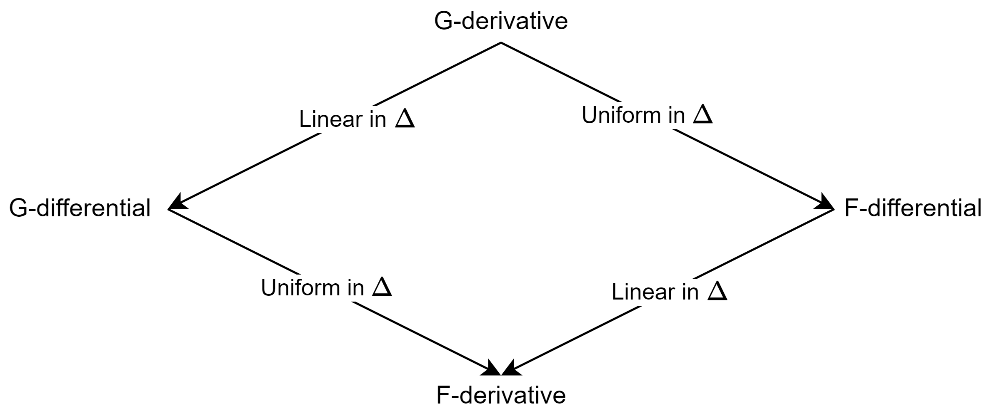

Sometimes notions in one-dimensional spaces are not easy to generalize to multi-dimensional spaces. I believe the notion of a differential (or the derivative in one-dimensional space) is one of them.

# Differentials: useful but naive surrogates

In one-dimensional calculus, students are typically introduced to the definition of the derivative of a function $f:\mathbb{R}\mapsto\mathbb{R}$ by constructive means. Specifically, if 

$$
(\theta)\qquad\lim_{t\downarrow0}\frac{f(x+t)-f(x)}{t}=\lim_{t\uparrow0}\frac{f(x+t)-f(x)}{t}=\lim_{t\to0}\frac{f(x+t)-f(x)}{t}=f'(x)
$$

then $f'(x)$ is called the (univariate) **derivative of $f$ at $x$**. In this special setting, the existence of $f'(x)$ enjoys all the nice properties of the F-derivative (e.g., continuity and tangency) and G-derivative (e.g., chain rule) *without the issues of construction*.

It is then natural to ask whether $(\theta)$ could be extended to the multivariate setting while simultaneously keeping (i) its constructive nature *and* (ii) the nice properties of the F-derivative (and G-derivative). Below, we show an approach of obtaining (i) which partially obtains (ii).

A function $f:\mathbb{R}^{n}\mapsto\mathbb{R}^{m}$ is said to have a **Gateaux** (or **G-**) **differential** **at** $x\in\mathbb{R}^{n}$ in the direction $\Delta\in\mathbb{R}^{n}$ if the function 

$$
(\pi_{1})\qquad V^{f}(x,\Delta)=\lim_{t\to0}\frac{f(x+t\Delta)-f(x)}{t},
$$

called the G-differential, is well-defined. Here, the limit is taken over all sequences $\{t_{n}\}\subseteq\mathbb{R}$ tending to zero. If, in addition, 

$$
(\pi_{2})\qquad\lim_{\Delta\to0}\frac{\|f(x+\Delta)-f(x)-V^{f}(x,\Delta)\|}{\|\Delta\|}=0
$$

where the limit is taken over all sequences $\{\Delta_{n}\}\subseteq\mathbb{R}^{n}$ tending to zero, then $f$ is also said to have a **Fréchet** (or **F-**) **differential at** $x\in\mathbb{R}^{n}$ (also denoted by $V^{f}(x,\Delta)$).

Let us now make a few glancing remarks.

-   Unlike the definitions of an F-derivative or G-derivative, the definition of $V^{f}$ in $(\pi_{1})$ is constructive.

-   Similar to the one-dimensional case, the well-definedness of $V^{f}(x,\Delta)$ is equivalent to the left and right limits (in terms of $t$) being equal.

-   In the one-dimensional case of $n=m=1$, we have $V^{f}(x,1)=f'(x)=-V^{f}(x,-1).$

-   It is straightforward to see that if $V^{f}(x,\Delta)$ exists for all $\Delta\in\mathbb{R}^{n}$ and is linear in $\Delta$ then $V^{f}(x,\Delta)={\cal B}_{x}^{f}(\Delta)$. Furthermore, if $(\pi_{2})$ holds then $V^{f}(x,\Delta)={\cal A}_{x}^{f}(\Delta)$.

While we have fulfilled property (i), the following anti-properties (given as exercises) show that property (ii) cannot be fully realized.

-   *Exercise*. Consider the function

    $$
    f(x_{1},x_{2})=\begin{cases}
        0, & \text{if }x=0,\\
        \dfrac{x_{1}x_{2}^{2}}{x_{1}^{2}+x_{2}^{4}}, & \text{otherwise}.
    \end{cases}
    $$

    Show that $V^{f}(0,\Delta)$ exists for every $\Delta\in\mathbb{R}^{2}$, but $f$ does not have a G-derivative at zero. As a bonus, show that $f$ is not continuous at zero.

    

    
Show solution

    If $\Delta_{1}=0$ or $\Delta_{2}=0$, then $f(t\Delta)=0$ for all $t$, so $V^{f}(0,\Delta)=0$. If $\Delta_{1}\neq 0$ and $\Delta_{2}\neq 0$, then

    $$
    V^{f}(0,\Delta)=\lim_{t\to 0}\frac{t^{3}\Delta_{1}\Delta_{2}^{2}}{t(t^{2}\Delta_{1}^{2}+t^{4}\Delta_{2}^{4})}=\lim_{t\to 0}\frac{\Delta_{1}\Delta_{2}^{2}}{\Delta_{1}^{2}+t^{2}\Delta_{2}^{4}}=\frac{\Delta_{2}^{2}}{\Delta_{1}}.
    $$

    Thus $V^{f}(0,\Delta)$ exists for every $\Delta\in\mathbb{R}^{2}$, but it is **not linear** in $\Delta$: $V^{f}(0,(1,0))=V^{f}(0,(0,1))=0$, whereas $V^{f}(0,(1,1))=1\neq 0+0$. Hence $f$ has no G-derivative at zero. For the bonus, along $x_{1}=x_{2}^{2}$ ($x_{2}\neq 0$), $f(x_{2}^{2},x_{2})=\frac{x_{2}^{4}}{2x_{2}^{4}}=\frac{1}{2}\not\to 0=f(0,0)$, so $f$ is discontinuous at zero.

    

-   *Exercise*. Consider the function

    $$
    f(x_{1},x_{2})={\rm sgn}(x_{2})\min(|x_{1}|,|x_{2}|)
    $$

    which is clearly continuous at zero. Show that $V^{f}(0,\Delta)$ exists for every $\Delta\in\mathbb{R}^{2}$, but $f$ does not have a G-derivative at zero.

    

    
Show solution

    Observe that $f$ is homogeneous of degree $1$ for all $t\in\mathbb{R}$ (both $t>0$ and $t<0$), since $\operatorname{sgn}(t\Delta_{2})|t|=t\operatorname{sgn}(\Delta_{2})$:

    $$
    f(t\Delta)=\operatorname{sgn}(t\Delta_{2})\min(|t||\Delta_{1}|,|t||\Delta_{2}|)=t\,f(\Delta).
    $$

    Consequently, $\frac{f(t\Delta)-f(0)}{t}=f(\Delta)$ for every $t\neq 0$, so $V^{f}(0,\Delta)=f(\Delta)$ exists for all $\Delta\in\mathbb{R}^{2}$. However, $V^{f}(0,\Delta)$ is **not linear** in $\Delta$: $V^{f}(0,(1,0))=V^{f}(0,(0,1))=0$, while $V^{f}(0,(1,1))=1\neq 0+0$, so $f$ has no G-derivative at zero.

    

On the other hand, the nice property about the G-differential (resp. F-differential) is that it gives a good initial estimate for the G-derivative (or F-derivative) if one can extract the appropriate linear form from it (and verify property $(\pi_{2})$ in the case of the F-derivative) or we know that $f$ is G-differentiable (resp. F-differentiable). A classic example of the utility of the differential is in deriving the derivative of the log determinant of a matrix, which we show below.

Let $f:{\cal S}_{++}^{n}\mapsto\mathbb{R}$ be given by $f(M)=\log\det M$, where ${\cal S}_{++}^{n}$ denotes the space of positive definite matrices. Since $\log(\cdot)$ is differentiable on $\mathbb{R}_{++}$ and $h(M)=\det(M)$ is a polynomial function of the components of $M$ (and, hence differentiable) we can obtain the derivative of $f$ by differentials and the chain rule. Using some standard linear algebra techniques, the F-differential of $h$ (and, hence, the F-derivative of $h$) is then given by 

$$
\begin{aligned}
V^{h}(M,\Delta) & =\lim_{t\to0}\frac{\det(M+t\Delta)-\det(M)}{t}\\
 & =\lim_{t\to0}\frac{\det(M[I+tM^{-1}\Delta])-\det(M)}{t}\\
 & =\det(M)\lim_{t\to0}\frac{\det(I+tM^{-1}\Delta)-1}{t}\\
& =\det(M){\rm tr}(M^{-1}\Delta)={\cal A}_{M}^{h}(\Delta),\end{aligned}
$$

 Hence, by the chain rule, we have 

$$
{\cal A}_{M}^{f}(\Delta)={\cal A}_{\det M}^{\log(\cdot)}{\cal A}_{M}^{h}(\Delta)=\frac{\det(M){\rm tr}(M^{-1}\Delta)}{\det(M)}={\rm tr}(M^{-1}\Delta).
$$

 One can even obtain the gradient $\nabla f(M)=M^{-T}$ by using the fact that 

$$
{\cal A}_{M}^{f}(\Delta)={\rm tr}(M^{-1}\Delta)=\left\langle M^{-T},\Delta\right\rangle .
$$

To close, let us present this nice schematic of the various relations between G/F-derivatives and G/F-differentials in terms of the displacement variable $\Delta$ that shows up in ${\cal A}_{x}^{f}(\Delta)$, ${\cal B}_{x}^{f}(\Delta)$, and $V^{f}(x,\Delta)$.

